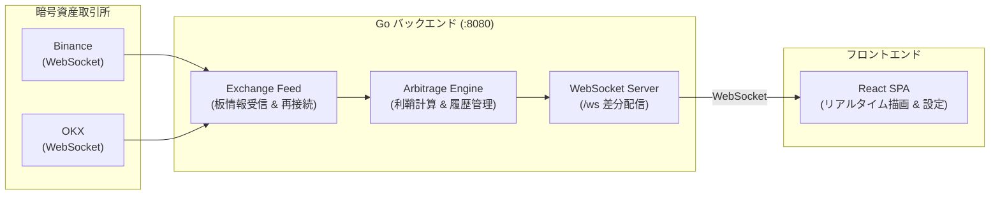

# Crypto Arbitrage Detector

暗号資産取引所（Binance と OKX）の板（オーダーブック）をリアルタイムに監視し、取引所間の価格差から手数料を差し引いても利益が出る機会を検知して画面に表示するツールです。

※ 本ツールは価格差を検知して画面に表示するだけで、注文は出しません。

## 主な特徴

- 各取引所の板を WebSocket で受信し、板が更新されるたびに両方向（一方で買って他方で売る）の損益を計算します。
- 最良気配だけでなく板の各段を突き合わせ、買いと売りの taker 手数料を引いても利益が出る数量と純利益を求めます。
- 画面には、有利な売買の方向、指定した取引金額での損益、各取引所の最良気配、検知履歴を表示します。
- Docker イメージのビルド時にフロントエンドを Go のバイナリに埋め込み、1つのコンテナで動かします。

## アーキテクチャ



## 技術スタック

| 対象 | 使用技術 |
| --- | --- |
| バックエンド | Go、gorilla/websocket、shopspring/decimal |
| フロントエンド | React、TypeScript、Vite、Biome |
| 実行環境 | Docker、Docker Compose |

## クイックスタート

Docker環境があれば、ローカルにGoやNode.jsをインストールすることなく起動できます。

```bash
# 本番相当（単一コンテナで起動）
docker compose up --build
```

起動後、ブラウザで `http://localhost:8080` にアクセスします。

### 開発環境での起動

```bash
# バックエンドとフロントエンドをホットリロード付きで起動
make dev
```

- フロントエンド（開発UI）: `http://localhost:3000`
- バックエンド（API / WebSocket）: `http://localhost:8080`。画面は配信しないため、ブラウザで開くと上のフロントエンドの URL を 503 で案内します。

## 主なコマンド

```bash
make fmt    # コード整形（Go: gofmt/goimports, TS: Biome）
make test   # テスト実行（Go, Vitest）
make lint   # 静的検査（go vet, golangci-lint, 型検査, Biome）
```

## 設定方法

監視対象の通貨ペアや取引所の手数料率は `backend/config.json` に書きます。このファイルはビルド時にバイナリへ埋め込まれます。開発環境（`make dev`）では変更を検知してサーバーが自動で再起動し、本番相当（`docker compose up --build`）ではイメージを作り直したときに反映されます。

| キー | 内容 |
| --- | --- |
| `server.addr` | 待ち受けアドレス |
| `server.allowedOrigins` | WebSocket の接続を許可する追加の Origin。同一オリジンは常に許可する |
| `exchanges` | 取引所ごとの `id`（`binance`・`okx`）、表示名 `name`、taker 手数料率 `takerFeeRate`（`0.001` = 0.1%）、接続先 `wsUrl`（省略時は取引所の既定の URL） |
| `pairs` | 監視する通貨ペア（`BASE/QUOTE`）。並び順が画面の初期表示順になる |
| `history.limit` | サーバーが保持する検知履歴の件数 |
| `log.level`・`log.format` | ログの出力レベル（`debug`・`info`・`warn`・`error`）と形式（`text`・`json`） |

起動時には、埋め込んだ設定を次の順に上書きできます（下の行が優先）。

| 方法 | 上書きする内容 |
| --- | --- |
| `-config` オプション（省略時は環境変数 `ARB_CONFIG`）で指定した JSON ファイル | ファイルに書いたキー |
| 環境変数 `ARB_ADDR`・`ARB_LOG_LEVEL`・`ARB_LOG_FORMAT` | `server.addr`・`log.level`・`log.format` |

## アクセス解析

本番サイトは専用の Google Analytics 4 プロパティで計測します。設定の入口は [Google Analytics](https://analytics.google.com/analytics/web/#/a154552231p557168511/reports/intelligenthome) です。タイムゾーンは日本時間、レポート通貨は日本円です。

[ユーザー分析ダッシュボード](https://analytics.google.com/analytics/web/#/a154552231p557168511/reports/builder/15952110116) では、新規・再訪ユーザー、利用時間、流入元、端末、国、操作イベントを確認できます。

`frontend/src/analytics.ts` が本番ビルドかつ本番オリジンの場合だけタグを読み込みます。ローカル開発・プレビューは集計しません。本番ドメインや測定ストリームを変更するときは、このファイルの公開識別子・オリジンと Google Analytics 側のストリームをそろえてください。

ページビュー・流入元・新規／再訪・利用時間・端末・地域に加えて、次の操作を計測します。

| イベント | 計測する操作 | 追加パラメータ |
| --- | --- | --- |
| `dashboard_ready` | 配信データを受信して画面が利用可能になった | なし |
| `language_changed` | 表示言語の変更 | `ui_language` |
| `theme_changed` | 配色の変更 | `ui_theme` |
| `pair_visibility_changed` | 通貨ペアの表示／非表示 | `pair_symbol`、`visible` |
| `pairs_reset` | すべての通貨ペアを再表示 | なし |
| `pair_reordered` | 通貨ペアの並べ替え | `pair_symbol`、`interaction_method` |
| `amount_changed` | 金額欄の編集後にフォーカスを移動 | なし |
| `fee_info_opened` | 手数料の説明をボタンで表示 | なし |

表示言語と配色はユーザー属性 `ui_language`・`ui_theme` にも反映します。取引金額・利益・板データ・個人を識別するユーザーIDは送信しません。URLと参照元からクエリと断片を除き、変化する利益通知タイトルの代わりに固定ページ名を使います。

広告向けの Google シグナルと広告のパーソナライズは無効です。拡張計測はページビュー・スクロール・離脱クリックを使い、フォーム・検索・動画・ダウンロードは無効にしています。解析タグがブロックされた場合も監視画面は動作します。

## ディレクトリ構成

```text
crypto-arbitrage-detector/
├── backend/
│   ├── cmd/server/            # サーバー起動・エントリポイント
│   ├── internal/
│   │   ├── app/               # 各部品の組み立てと HTTP サーバーの起動・停止
│   │   ├── arbitrage/         # 板突き合わせ・利鞘計算ロジック
│   │   ├── config/            # 設定の読み込み・検証
│   │   ├── domain/            # 取引所・通貨ペア・板の型
│   │   ├── engine/            # 板の保持・判定・機会の履歴管理
│   │   ├── exchange/          # 取引所への WebSocket 接続（共通の再接続処理、Binance / OKX 固有の処理）
│   │   ├── server/            # クライアントへの WebSocket 配信
│   │   ├── webui/             # 埋め込んだフロントエンドの配信
│   │   └── wire/              # 配信する JSON の形式
│   ├── scripts/dev.sh         # 開発時にソースの変更を検知してサーバーを再起動
│   └── config.json            # 通貨ペア・取引所設定
└── frontend/
    └── src/
        ├── components/        # UIコンポーネント（カード、ヘッダー、履歴等）
        ├── format/            # 数値の表示整形
        ├── hooks/             # React のフック（配信の受信、表示設定の保存など）
        ├── i18n/              # 日本語・英語の文言
        ├── protocol/          # 配信 JSON の型と解釈
        ├── state/             # リアルタイム状態管理
        └── ws/                # 自動再接続付きWebSocketクライアント
```
